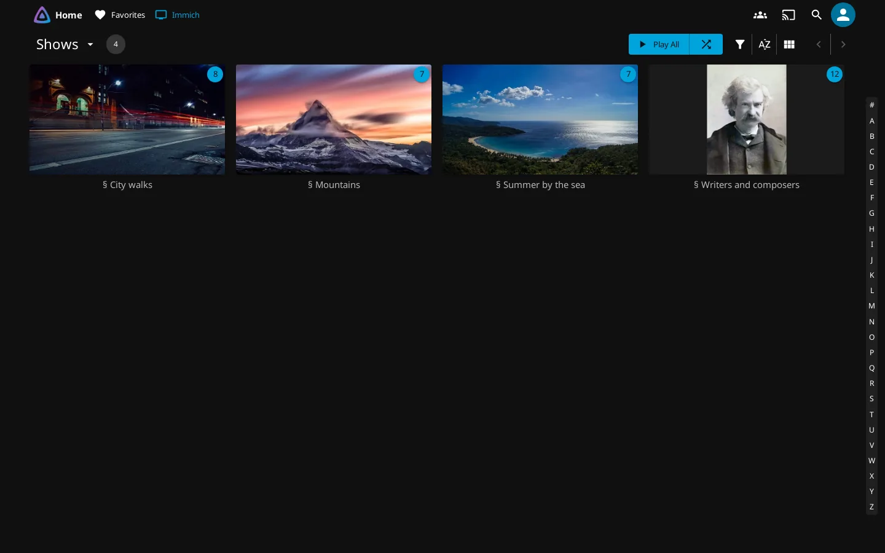
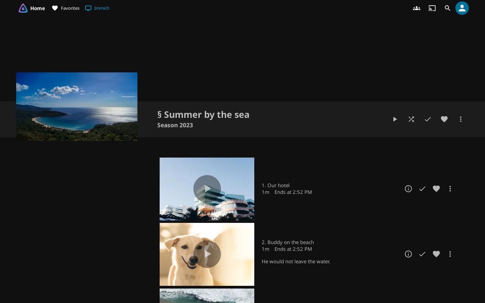
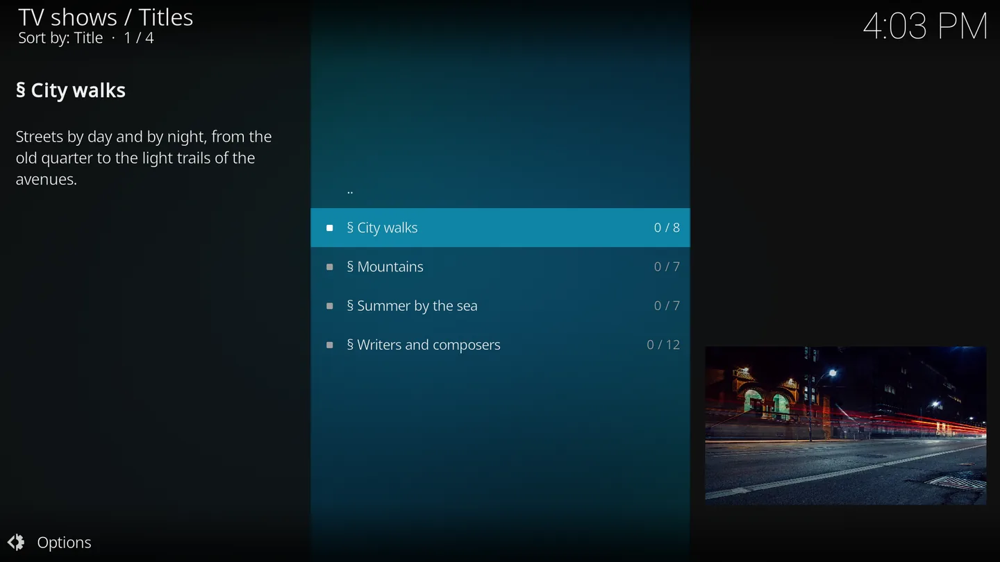
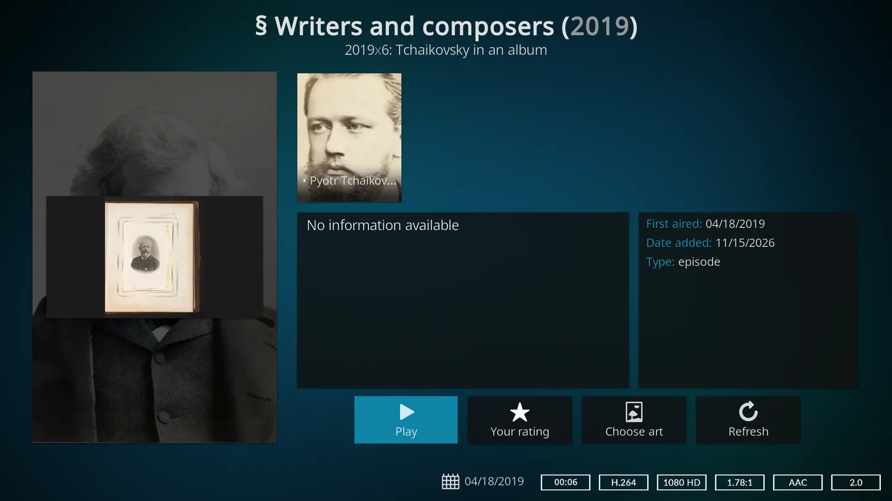
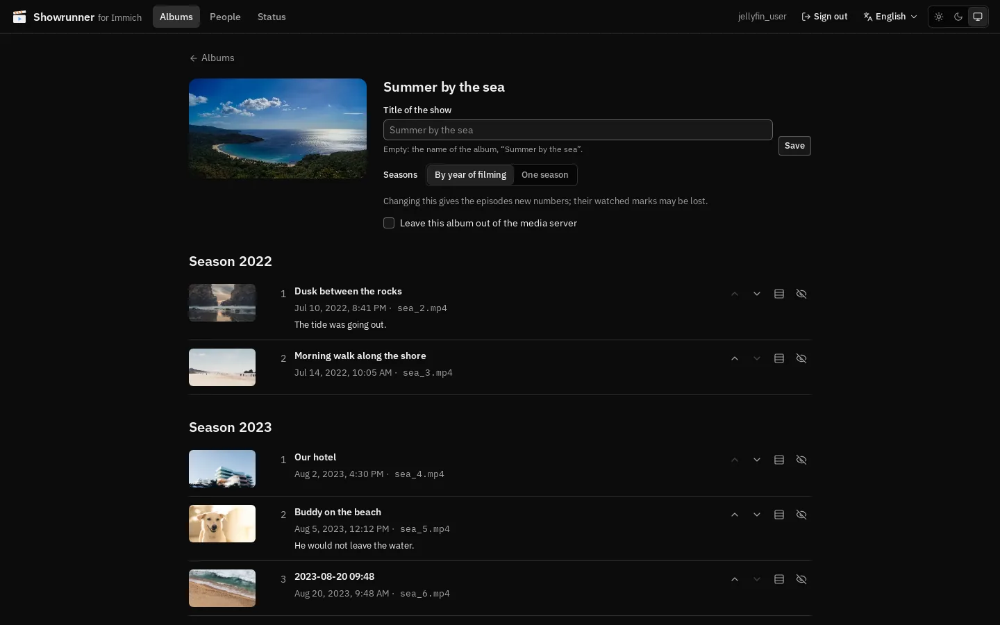
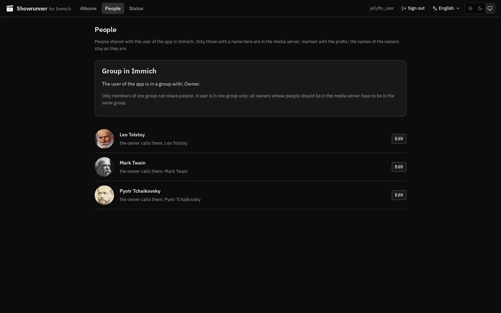

<p align="center">
  
</p>

<h1 align="center">Showrunner for Immich</h1>

<p align="center">
  Vos albums Immich comme séries dans Jellyfin et Kodi — chaque vidéo un épisode, aucun fichier copié.
</p>

<p align="center">
  <a href="https://github.com/Ivamic/immich-showrunner/releases"></a>
  <a href="https://github.com/Ivamic/immich-showrunner/actions/workflows/ci.yml"></a>
  <a href="LICENSE"></a>
  
</p>

<p align="center">
  <a href="README.md">English</a> · <a href="README.de.md">Deutsch</a> · <b>Français</b> · <a href="README.it.md">Italiano</a> · <a href="README.ru.md">Русский</a>
</p>

> **État : développement précoce.** Les albums partagés deviennent des séries dans Jellyfin et Kodi
> avec affiches, images et personnes, suivent les changements dans Immich et se corrigent sur une page
> web. Attendez-vous à des bogues et à des changements entre les versions.

Fonctionne avec Immich 3, Jellyfin 12 et Kodi 21 ; Jellyfin peut tourner dans Docker ou être
installé comme paquet, Kodi lit son dossier par SMB.

Une application compagnon auto-hébergée pour [Immich](https://immich.app). Elle fait apparaître les
vidéos de vos albums Immich dans [Jellyfin](https://jellyfin.org) et [Kodi](https://kodi.tv) comme
des éléments ordinaires de la médiathèque : un album devient une série, chaque vidéo un épisode,
dans l’ordre du tournage. Les fichiers vidéo restent là où ils sont ; chaque serveur multimédia
reçoit un dossier de liens avec les métadonnées à côté.

Cas typique : des archives vidéo familiales conservées dans Immich, regardées à la télévision via
Jellyfin ou Kodi.

## Captures d’écran

<table>
  <tr>
    <td width="50%"><a href="docs/images/screenshots/jellyfin-shows.webp"></a><br><sub>Jellyfin : les albums comme séries</sub></td>
    <td width="50%"><a href="docs/images/screenshots/jellyfin-season.webp"></a><br><sub>Jellyfin : une saison, titres tirés des descriptions dans Immich</sub></td>
  </tr>
  <tr>
    <td width="50%"><a href="docs/images/screenshots/kodi-shows.webp"></a><br><sub>Kodi : les mêmes séries, depuis un dossier à lui</sub></td>
    <td width="50%"><a href="docs/images/screenshots/kodi-episode.webp"></a><br><sub>Kodi : les personnes avec leur visage venu d’Immich</sub></td>
  </tr>
  <tr>
    <td width="50%"><a href="docs/images/screenshots/app-album.webp"></a><br><sub>La page : un album, ses saisons et ses épisodes</sub></td>
    <td width="50%"><a href="docs/images/screenshots/app-people.webp"></a><br><sub>La page : les personnes et leurs noms</sub></td>
  </tr>
</table>

<sub>Les vidéos des captures sont faites à partir d’images de Wikimedia Commons du domaine public ou sous CC0.</sub>

## Idée

- **Vous choisissez dans Immich, pas dans une application de plus.** Créez un utilisateur Immich
  pour le serveur multimédia et partagez un album avec lui : ses vidéos apparaissent dans le
  serveur multimédia. Arrêtez de le partager, et elles disparaissent.
- **Album = série, vidéo = épisode.** Les saisons sont les années de tournage, ou une seule saison
  par album. Le titre d’un épisode est la première ligne de la description de la vidéo dans
  Immich, ou l’heure du tournage ; l’affiche et les images des épisodes sont celles d’Immich.
- **Les personnes d’Immich**, sous des noms à elles pour le serveur multimédia (« Maman » peut
  rester « Maman » chez vous), marquées d’un court préfixe pour ne jamais se mêler aux acteurs de
  votre filmothèque.
- **Fonctionne tout seul**, avec une page web pour les cas où il a mal deviné : renommer une série
  ou un épisode, changer l’ordre, masquer une vidéo, nommer et décrire des personnes. En anglais,
  allemand, français, italien et russe.
- **Jellyfin, Kodi ou les deux.** Un dossier pour chacun, à partir des mêmes albums et des mêmes
  corrections, et chacun est prévenu de chaque changement. Kodi n’a besoin d’aucune extension et
  ne cherche rien sur internet ; Kodi avec l’extension Jellyfin voit les séries par Jellyfin.

## Principes

- **Pas de copies.** Aucun fichier vidéo n’est dupliqué.
- **La bibliothèque Immich est en lecture seule.** L’application ne modifie, ne déplace ni ne
  supprime jamais les fichiers d’Immich. Elle n’écrit que dans ses propres dossiers et n’y supprime
  que ce qu’elle a créé.
- **Rien n’est écrit dans Immich de lui-même.** La synchronisation en arrière-plan utilise une clé
  d’API en lecture seule, et vos corrections sont conservées dans la base de données de
  l’application. Les exceptions sont ce que vous faites vous-même sur la page pour l’utilisateur
  du serveur multimédia : nommer une personne partagée avec lui (pour cet utilisateur seulement)
  et accepter une invitation dans un groupe.
- **Reconstructible.** Les dossiers des serveurs multimédias peuvent être supprimés et reconstruits.

## Installation

Showrunner tourne avec Docker Compose sur la machine qui contient la bibliothèque Immich ; Jellyfin
peut tourner dans Docker ou être installé comme paquet, et Kodi lit son dossier par SMB. L’image
est prête, pour `amd64` et `arm64` :

```sh
mkdir immich-showrunner && cd immich-showrunner
curl -L -o compose.yaml https://github.com/Ivamic/immich-showrunner/releases/latest/download/compose.yaml
curl -L -o example.env https://github.com/Ivamic/immich-showrunner/releases/latest/download/example.env
cp example.env .env      # adresses et clés d'Immich, de Jellyfin et de Kodi, dossiers
docker compose run --rm app check
docker compose run --rm app sync --dry-run
docker compose up -d
```

Mise à jour : `docker compose pull && docker compose up -d`. [Installation pas à
pas](docs/install.md) (en anglais) : l’utilisateur et la clé d’API dans Immich, la correspondance
des chemins, les médiathèques dans Jellyfin et Kodi, la page web, les personnes.

## Architecture

- Python (FastAPI), PostgreSQL ; un conteneur pour l’application et un pour sa base de données.
- La page web est une application SvelteKit intégrée à l’image et servie par l’application.
- Le conteneur de l’application ne monte que ses dossiers de sortie. Il lit Immich par l’API avec
  une clé en lecture seule et ne voit jamais les fichiers de la bibliothèque.
- Une synchronisation établit d’abord un plan à partir de ce que dit Immich et du registre des
  fichiers créés par l’application, puis l’exécute ; `sync --dry-run` s’arrête après le plan.

## Soutenir le projet

Showrunner est gratuit et développé sur le temps libre. S’il vous est utile, vous pouvez soutenir
son développement par un don en cryptomonnaie. Une étoile sur le dépôt, les rapports de bogues et
le partage du projet aident aussi.

| Monnaie | Réseau | Adresse |
|---|---|---|
| USDT | TRON (TRC-20) | `TAqGEvmDTw2ro4BKQmcPPtqK5xEMfNaiSX` |
| ETH, USDT et autres jetons | Ethereum et réseaux EVM (Base, Polygon, Arbitrum…) | `0x783C192d69fE5E9DAfa1dC2c41FeE272122AE031` |
| SOL | Solana | `38gidbL2ocv5c6CK7zP7c3QWVHisYyqhnrMV3tuaYpgp` |
| BTC | Bitcoin | `bc1qsdys5hvx7vlxp25mz77hfgz2l35x8klc8z2npx` |

Vérifiez le réseau avant d’envoyer : des fonds envoyés par un autre réseau peuvent être perdus.

## Licence

Copyright (C) 2026 Ivamic.

[GNU Affero General Public License v3.0 ou ultérieure](LICENSE) (`AGPL-3.0-or-later`).

**Nom et logo.** Le nom « Showrunner for Immich » et son logo (`docs/images/logo.svg`,
`frontend/src/lib/assets/favicon.svg` et la marque dessinée dans `frontend/src/lib/ui/Brand.svelte`)
ne sont pas sous licence AGPL ; tous les droits sont réservés à l’auteur. Vous pouvez les utiliser
pour faire référence à ce projet. Les forks et versions modifiées doivent utiliser un autre nom et
un autre logo.

## Assistance de l’IA

Ce projet est développé avec l’aide d’outils d’IA (Claude d’Anthropic). Tout le code est relu et
maintenu par un auteur humain.

## Avertissement

Ceci est un projet communautaire indépendant. Il n’est ni affilié ni approuvé par le projet Immich,
FUTO, le projet Jellyfin ou la Kodi Foundation.
