<p align="center">
  
</p>

<h1 align="center">Showrunner for Immich</h1>

<p align="center">
  I tuoi album di Immich come serie in Jellyfin e Kodi — ogni video un episodio, nessun file copiato.
</p>

<p align="center">
  <a href="https://github.com/Ivamic/immich-showrunner/releases"></a>
  <a href="https://github.com/Ivamic/immich-showrunner/actions/workflows/ci.yml"></a>
  <a href="LICENSE"></a>
  
</p>

<p align="center">
  <a href="README.md">English</a> · <a href="README.de.md">Deutsch</a> · <a href="README.fr.md">Français</a> · <b>Italiano</b> · <a href="README.ru.md">Русский</a>
</p>

> **Stato: sviluppo iniziale.** Gli album condivisi diventano serie in Jellyfin e Kodi con
> locandine, immagini e persone, seguono le modifiche in Immich e si correggono su una pagina web. Aspettati
> errori e cambiamenti tra le versioni.

Funziona con Immich 3, Jellyfin 12 e Kodi 21; Jellyfin può girare in Docker o essere installato
come pacchetto, Kodi legge la sua cartella via SMB.

Un’app di accompagnamento self-hosted per [Immich](https://immich.app). Fa comparire i video dei
tuoi album di Immich in [Jellyfin](https://jellyfin.org) e [Kodi](https://kodi.tv) come normali
elementi della libreria: un album diventa una serie, ogni video un episodio, nell’ordine delle
riprese. I file video restano dove sono; ogni media server riceve una cartella di collegamenti con
i metadati accanto.

Caso tipico: un archivio video di famiglia tenuto in Immich, guardato in TV tramite Jellyfin o
Kodi.

## Schermate

<table>
  <tr>
    <td colspan="2" width="100%"><a href="docs/images/screenshots/artwork-styles.webp">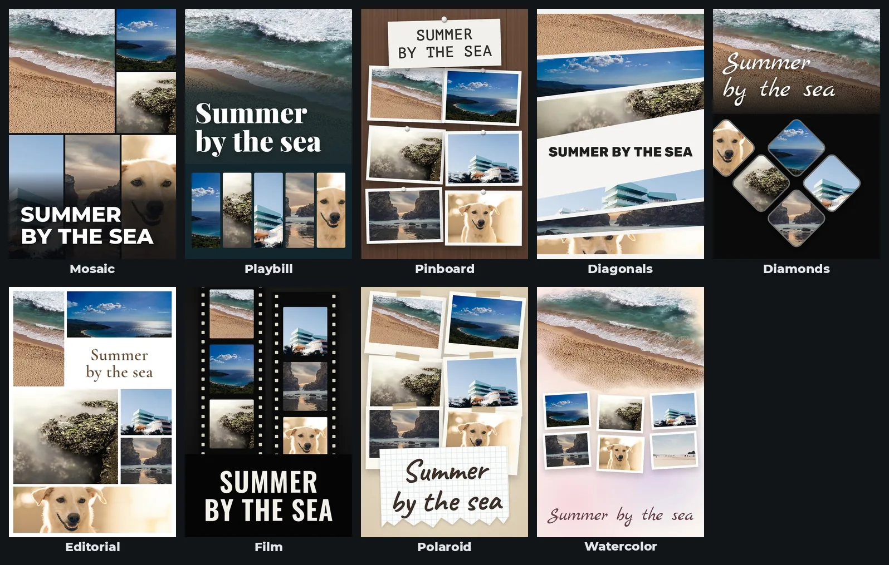</a><br><sub>Un album in ciascuno dei nove stili delle immagini disegnate</sub></td>
  </tr>
  <tr>
    <td width="50%"><a href="docs/images/screenshots/jellyfin-artwork-shows.webp">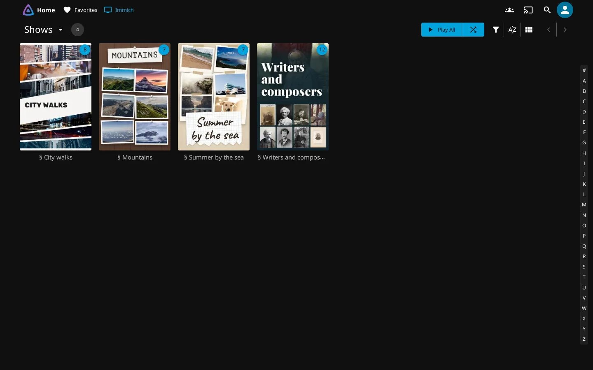</a><br><sub>Jellyfin: le serie con le loro locandine disegnate</sub></td>
    <td width="50%"><a href="docs/images/screenshots/jellyfin-artwork-show.webp">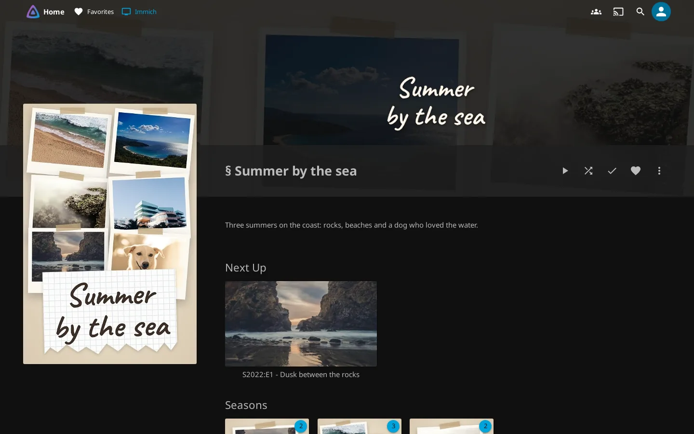</a><br><sub>Jellyfin: una serie con locandina, sfondo e logo disegnati</sub></td>
  </tr>
  <tr>
    <td width="50%"><a href="docs/images/screenshots/app-artwork.webp">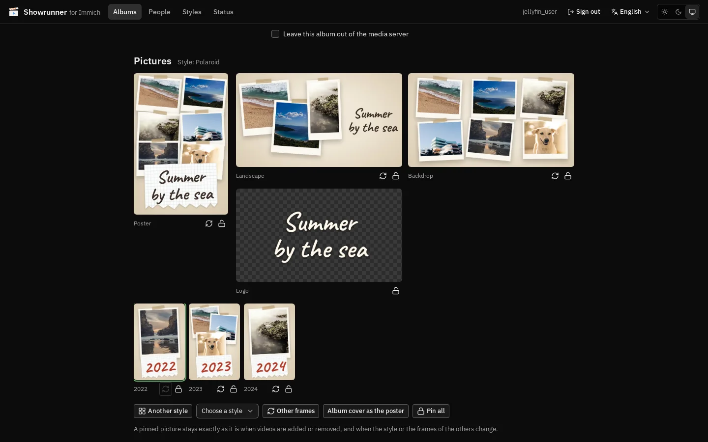</a><br><sub>La pagina: le immagini di un album, ognuna con altri fotogrammi e un lucchetto</sub></td>
    <td width="50%"><a href="docs/images/screenshots/app-artwork-look.webp">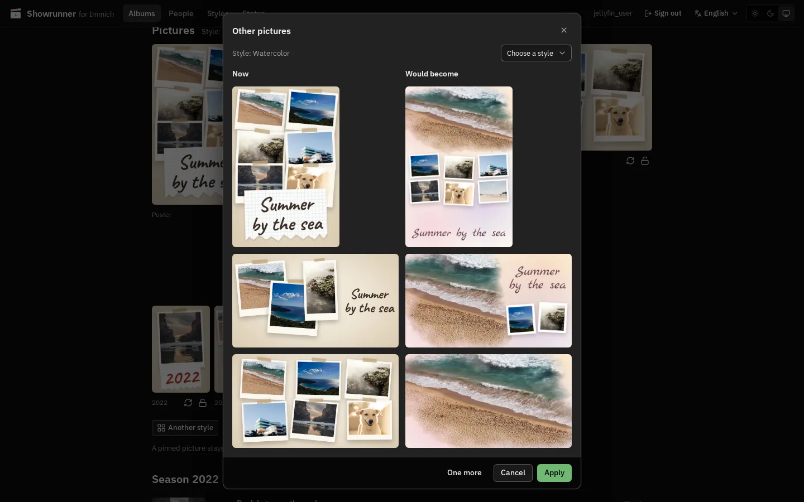</a><br><sub>La pagina: un altro stile, affiancato prima di applicarlo</sub></td>
  </tr>
</table>

<table>
  <tr>
    <td width="50%"><a href="docs/images/screenshots/jellyfin-shows.webp">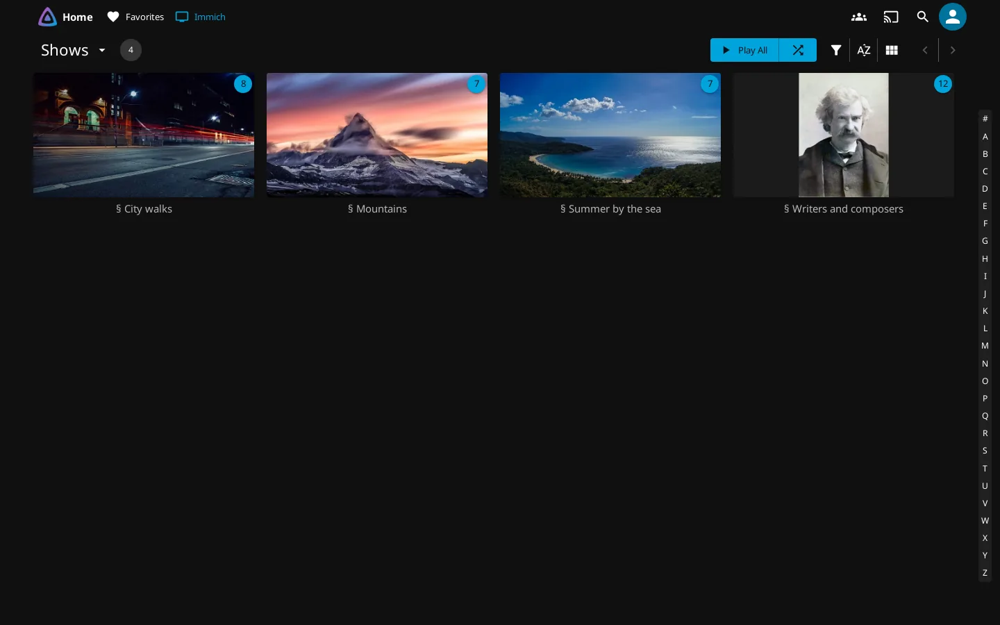</a><br><sub>Jellyfin: gli album come serie</sub></td>
    <td width="50%"><a href="docs/images/screenshots/jellyfin-season.webp">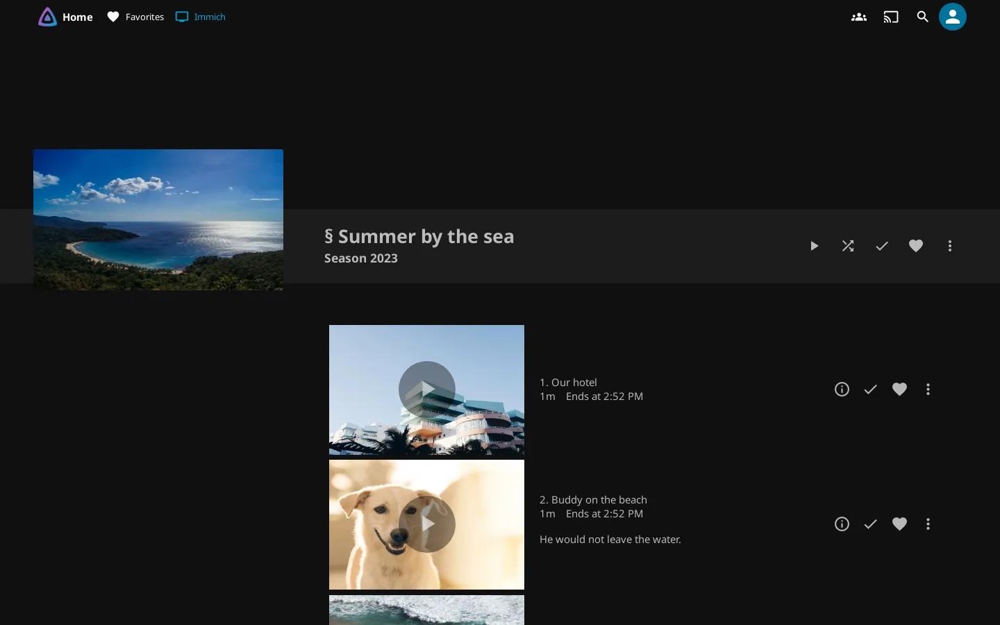</a><br><sub>Jellyfin: una stagione, titoli dalle descrizioni in Immich</sub></td>
  </tr>
  <tr>
    <td width="50%"><a href="docs/images/screenshots/kodi-shows.webp">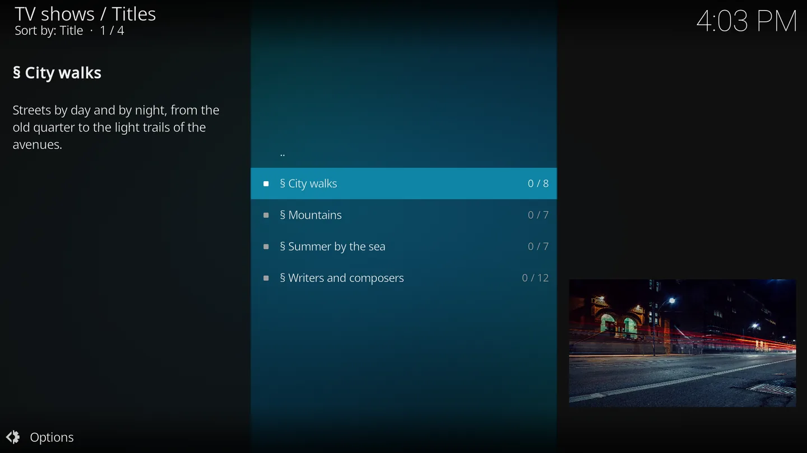</a><br><sub>Kodi: le stesse serie, da una cartella propria</sub></td>
    <td width="50%"><a href="docs/images/screenshots/kodi-episode.webp">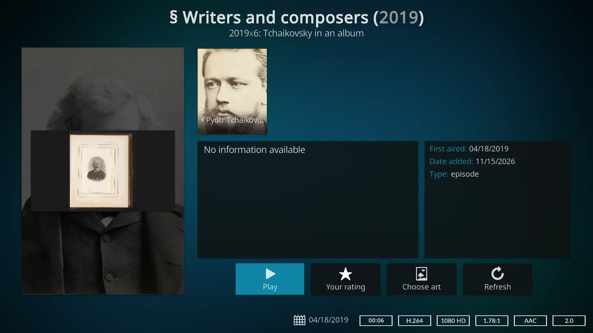</a><br><sub>Kodi: le persone con i volti di Immich</sub></td>
  </tr>
  <tr>
    <td width="50%"><a href="docs/images/screenshots/app-album.webp">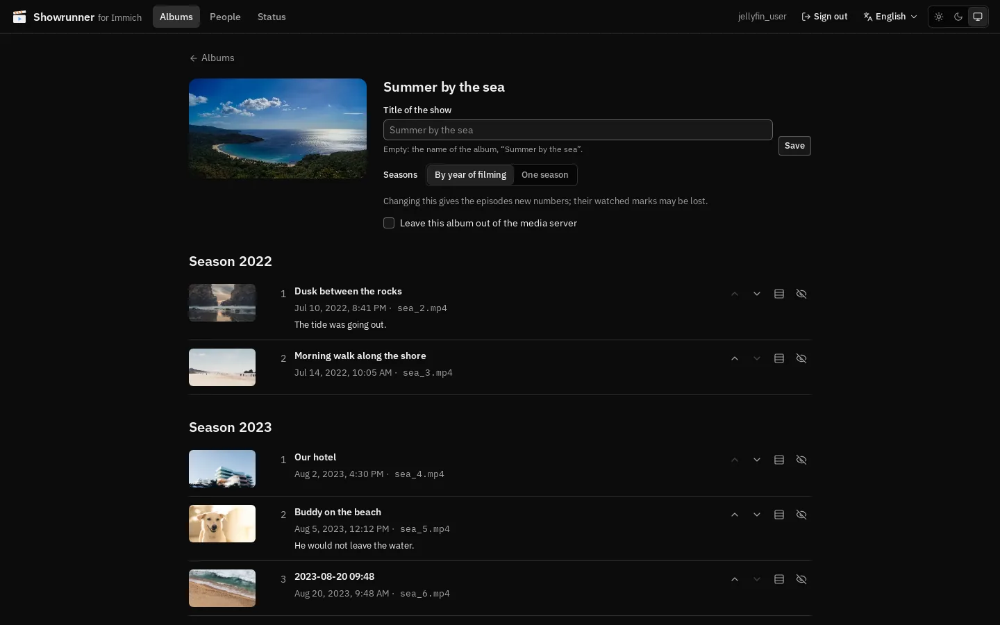</a><br><sub>La pagina: un album, le sue stagioni e i suoi episodi</sub></td>
    <td width="50%"><a href="docs/images/screenshots/app-people.webp">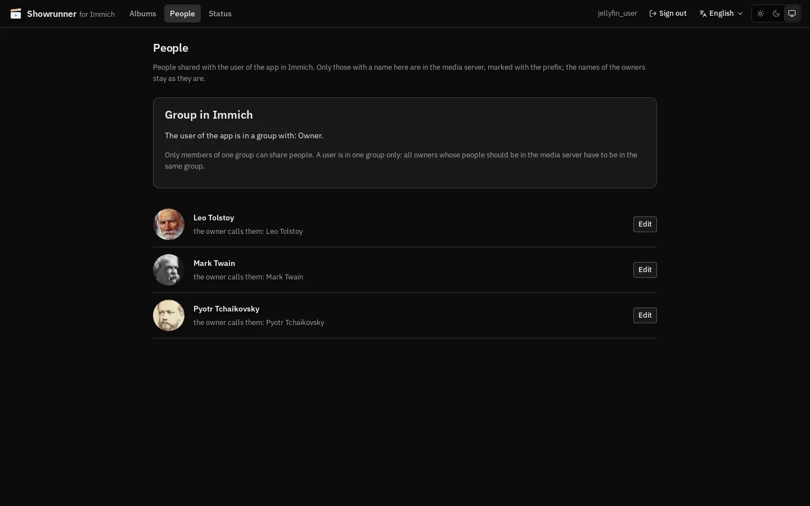</a><br><sub>La pagina: le persone e i loro nomi</sub></td>
  </tr>
</table>

<sub>I video delle schermate sono fatti con immagini di Wikimedia Commons di pubblico dominio o sotto CC0.</sub>

## Idea

- **Scegli in Immich, non in un’altra app.** Crea in Immich un utente per il media server e
  condividi un album con lui: i suoi video compaiono nel media server. Smetti di condividerlo, e
  spariscono.
- **Album = serie, video = episodio.** Le stagioni sono gli anni delle riprese, oppure una sola
  stagione per album. Il titolo di un episodio è la prima riga della descrizione del video in
  Immich, oppure l’ora della ripresa; le immagini degli episodi sono quelle di Immich.
- **Immagini proprie.** La locandina, l’immagine orizzontale, lo sfondo e il logo di una serie e una
  locandina per ogni stagione sono disegnati dai fotogrammi dei video dell’album, tenendo in vista i
  volti, in uno di nove stili. Senza generazione di immagini con l’IA: tutto gira sulla CPU del tuo
  server. Sulla pagina prova un altro stile o altri fotogrammi, per tutte le immagini o per una sola,
  e fissa quelle che ti piacciono.
- **Le persone di Immich**, con nomi propri per il media server («Mamma» può restare «Mamma» da
  te), segnate da un breve prefisso perché non si mescolino mai con gli attori della tua
  cineteca.
- **Funziona da solo**, con una pagina web per i casi in cui ha indovinato male: rinominare una
  serie o un episodio, cambiare l’ordine, nascondere un video, dare un nome e una descrizione alle
  persone. In inglese, tedesco, francese, italiano e russo.
- **Jellyfin, Kodi o entrambi.** Una cartella per ciascuno, dagli stessi album e con le stesse
  correzioni, ed entrambi vengono avvisati di ogni modifica. Kodi non ha bisogno di add-on e non
  cerca nulla su internet; Kodi con l’add-on di Jellyfin vede le serie tramite Jellyfin.

## Principi

- **Nessuna copia.** Nessun file video viene duplicato.
- **La libreria di Immich è in sola lettura.** L’app non modifica, sposta o elimina mai i file di
  Immich. Scrive solo nelle proprie cartelle e lì rimuove solo ciò che ha creato.
- **Niente viene scritto in Immich da solo.** La sincronizzazione in background usa una chiave API
  in sola lettura e le tue correzioni restano nel database dell’app. Le eccezioni sono ciò che fai
  tu stesso sulla pagina per l’utente del media server: dare un nome a una persona condivisa con
  lui (solo per quell’utente) e accettare un invito in un gruppo.
- **Ricostruibile.** Le cartelle per i media server possono essere eliminate e ricostruite.

## Installazione

Showrunner gira con Docker Compose sulla macchina che ospita la libreria di Immich; Jellyfin può
girare in Docker o essere installato come pacchetto, e Kodi legge la sua cartella via SMB.
L’immagine è già pronta, per `amd64` e `arm64`:

```sh
mkdir immich-showrunner && cd immich-showrunner
curl -L -o compose.yaml https://github.com/Ivamic/immich-showrunner/releases/latest/download/compose.yaml
curl -L -o example.env https://github.com/Ivamic/immich-showrunner/releases/latest/download/example.env
cp example.env .env      # indirizzi e chiavi di Immich, Jellyfin e Kodi, cartelle
docker compose run --rm app check
docker compose run --rm app sync --dry-run
docker compose up -d
```

Aggiornamento: `docker compose pull && docker compose up -d`. [Installazione passo
passo](docs/install.md) (in inglese): l’utente e la chiave API in Immich, la mappatura dei percorsi,
le librerie in Jellyfin e Kodi, la pagina web, le persone.

## Architettura

- Python (FastAPI), PostgreSQL; un container per l’app e uno per il suo database.
- La pagina web è un’app SvelteKit inclusa nell’immagine e servita dall’app.
- Il container dell’app monta solo le sue cartelle di output. Legge Immich tramite l’API con una
  chiave in sola lettura e non vede mai i file della libreria.
- Una sincronizzazione prima prepara un piano da ciò che riporta Immich e dal registro dei file
  creati dall’app, poi lo esegue; `sync --dry-run` si ferma dopo il piano.

## Sostieni il progetto

Showrunner è gratuito e sviluppato nel tempo libero. Se ti è utile, puoi sostenerne lo sviluppo
con una donazione in criptovaluta. Una stella al repository, le segnalazioni di errori e il
passaparola aiutano anche loro.

| Valuta | Rete | Indirizzo |
|---|---|---|
| USDT | TRON (TRC-20) | `TAqGEvmDTw2ro4BKQmcPPtqK5xEMfNaiSX` |
| ETH, USDT e altri token | Ethereum e reti EVM (Base, Polygon, Arbitrum…) | `0x783C192d69fE5E9DAfa1dC2c41FeE272122AE031` |
| SOL | Solana | `38gidbL2ocv5c6CK7zP7c3QWVHisYyqhnrMV3tuaYpgp` |
| BTC | Bitcoin | `bc1qsdys5hvx7vlxp25mz77hfgz2l35x8klc8z2npx` |

Controlla la rete prima di inviare: i fondi inviati su un’altra rete possono andare persi.

## Licenza

Copyright (C) 2026 Ivamic.

[GNU Affero General Public License v3.0 o successiva](LICENSE) (`AGPL-3.0-or-later`).

**Nome e logo.** Il nome «Showrunner for Immich» e il suo logo (`docs/images/logo.svg`,
`frontend/src/lib/assets/favicon.svg` e il marchio disegnato in `frontend/src/lib/ui/Brand.svelte`)
non sono concessi con la licenza AGPL; tutti i diritti sono riservati all’autore. Puoi usarli per
fare riferimento a questo progetto. Fork e versioni modificate devono usare un nome e un logo
diversi.

## Assistenza dell’IA

Questo progetto è sviluppato con l’aiuto di strumenti di IA (Claude di Anthropic). Tutto il codice
è revisionato e mantenuto da un autore umano.

## Avvertenza

Questo è un progetto indipendente della comunità. Non è affiliato né approvato dal progetto Immich,
da FUTO, dal progetto Jellyfin o dalla Kodi Foundation.
