<p align="center">
  
</p>

<h1 align="center">Showrunner for Immich</h1>

<p align="center">
  Альбомы Immich — сериалы в Jellyfin и Kodi: каждое видео — эпизод, ни один файл не копируется.
</p>

<p align="center">
  <a href="https://github.com/Ivamic/immich-showrunner/releases"></a>
  <a href="https://github.com/Ivamic/immich-showrunner/actions/workflows/ci.yml"></a>
  <a href="LICENSE"></a>
  
</p>

<p align="center">
  <a href="README.md">English</a> · <a href="README.de.md">Deutsch</a> · <a href="README.fr.md">Français</a> · <a href="README.it.md">Italiano</a> · <b>Русский</b>
</p>

> **Статус: ранняя разработка.** Альбомы, которыми поделились, становятся сериалами в Jellyfin и
> Kodi с постерами, картинками и людьми, следят за изменениями в Immich и правятся на веб-странице.
> Возможны ошибки и изменения между версиями.

Работает с Immich 3, Jellyfin 12 и Kodi 21; Jellyfin может быть в Docker или установлен пакетом,
Kodi читает свою папку по SMB.

Приложение-компаньон для [Immich](https://immich.app), которое ставится у себя. Видео из ваших
альбомов Immich появляются в [Jellyfin](https://jellyfin.org) и [Kodi](https://kodi.tv) как
обычные элементы медиатеки: альбом становится сериалом, каждое видео — эпизодом, в порядке
съёмки. Видеофайлы остаются на месте; каждый медиасервер получает свою папку ссылок с
метаданными рядом.

Типичный случай: семейный видеоархив хранится в Immich, а смотрят его на телевизоре через
Jellyfin или Kodi.

## Снимки экрана

<table>
  <tr>
    <td colspan="2" width="100%"><a href="docs/images/screenshots/artwork-styles.webp">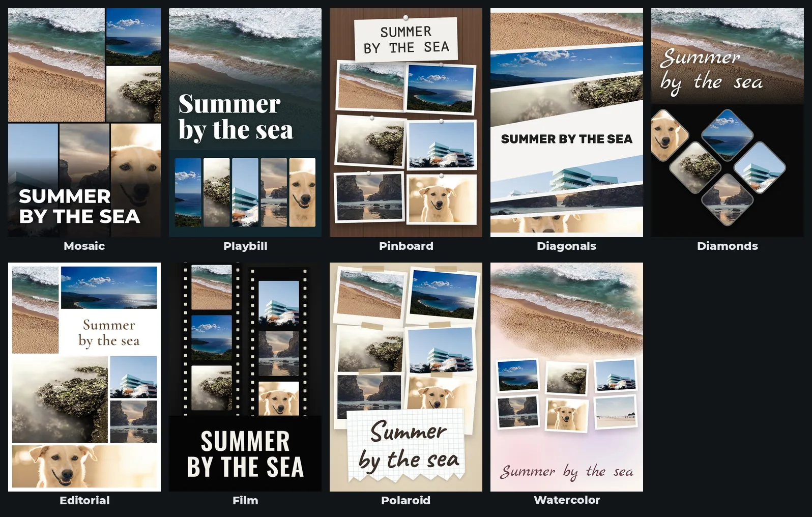</a><br><sub>Один альбом во всех девяти стилях нарисованных картинок</sub></td>
  </tr>
  <tr>
    <td width="50%"><a href="docs/images/screenshots/jellyfin-artwork-shows.webp">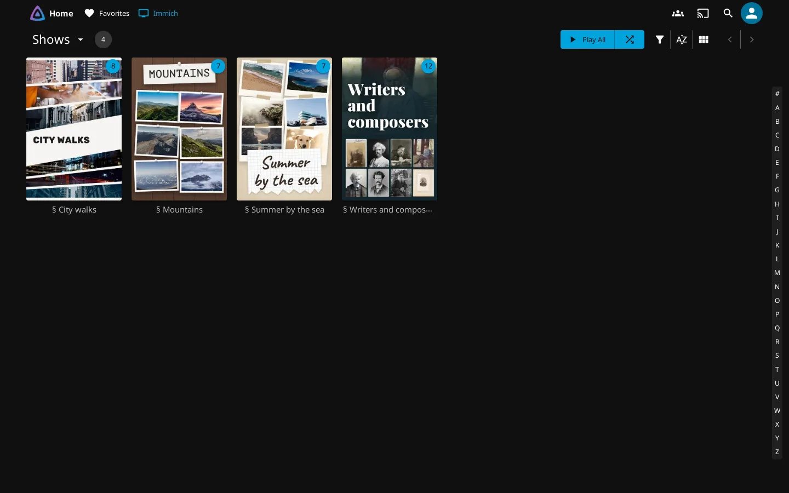</a><br><sub>Jellyfin: сериалы с нарисованными постерами</sub></td>
    <td width="50%"><a href="docs/images/screenshots/jellyfin-artwork-show.webp">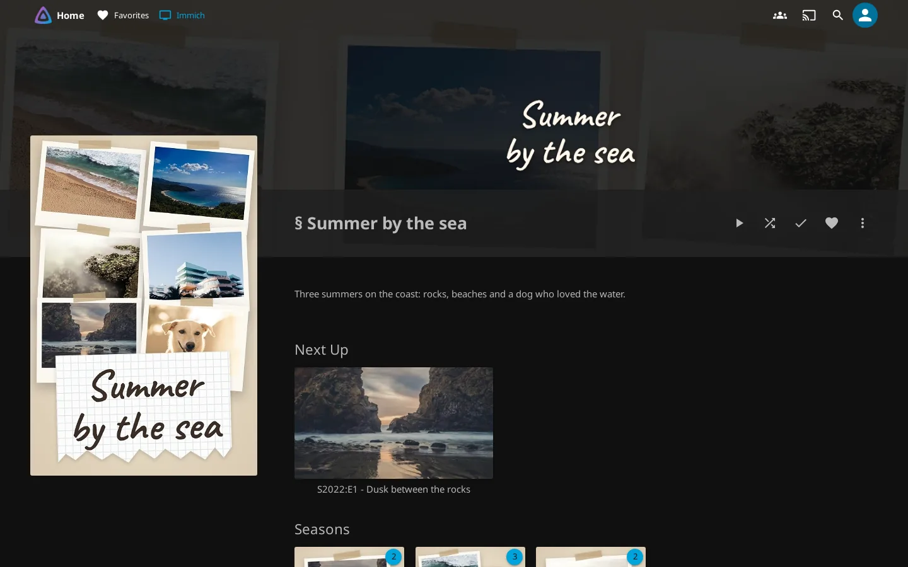</a><br><sub>Jellyfin: сериал с нарисованными постером, фоном и логотипом</sub></td>
  </tr>
  <tr>
    <td width="50%"><a href="docs/images/screenshots/app-artwork.webp">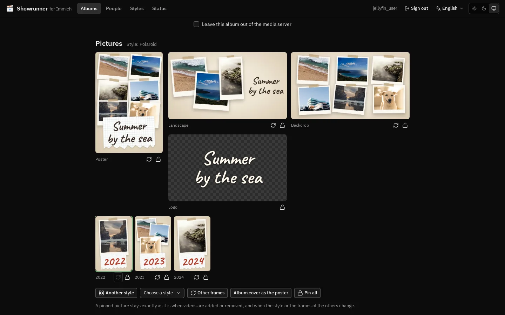</a><br><sub>Страница: картинки альбома, у каждой — другие кадры и замок</sub></td>
    <td width="50%"><a href="docs/images/screenshots/app-artwork-look.webp">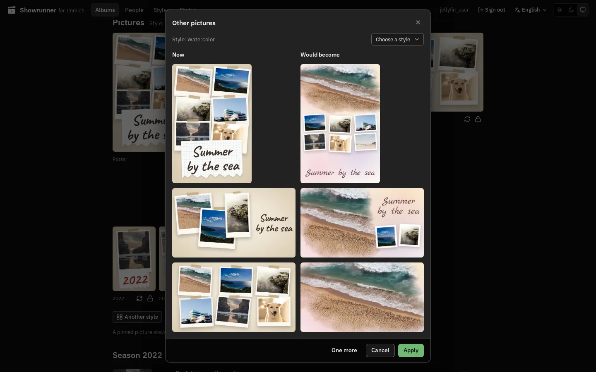</a><br><sub>Страница: другой стиль рядом с нынешним, до применения</sub></td>
  </tr>
</table>

<table>
  <tr>
    <td width="50%"><a href="docs/images/screenshots/jellyfin-shows.webp">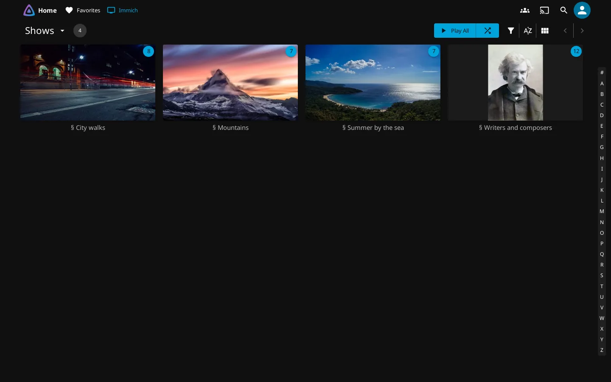</a><br><sub>Jellyfin: альбомы как сериалы</sub></td>
    <td width="50%"><a href="docs/images/screenshots/jellyfin-season.webp">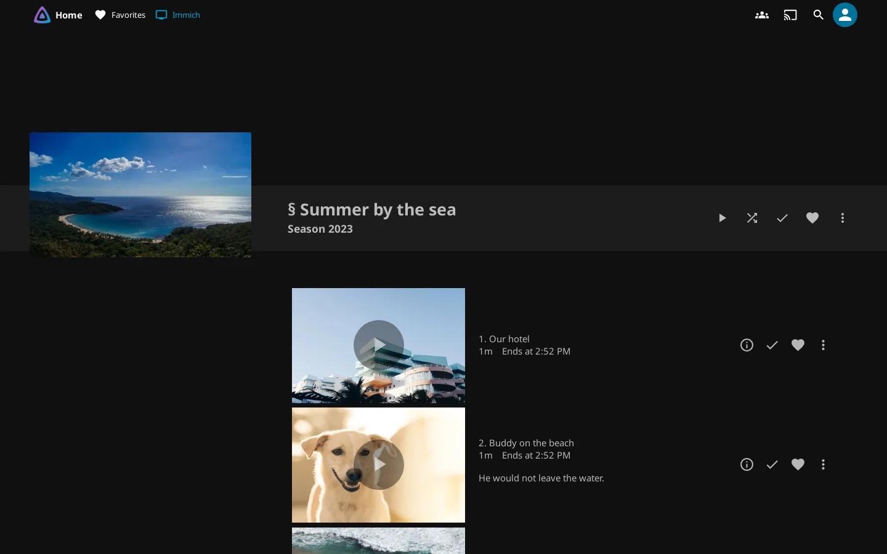</a><br><sub>Jellyfin: сезон, названия из описаний в Immich</sub></td>
  </tr>
  <tr>
    <td width="50%"><a href="docs/images/screenshots/kodi-shows.webp">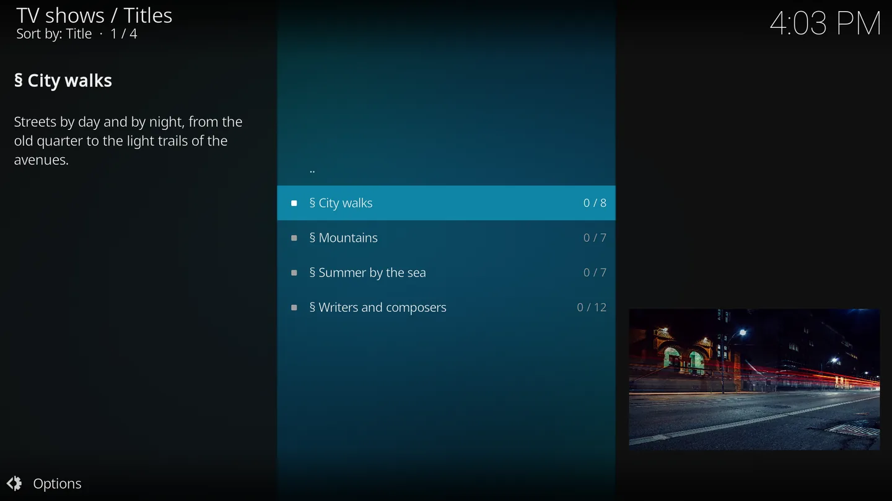</a><br><sub>Kodi: те же сериалы, из своей папки</sub></td>
    <td width="50%"><a href="docs/images/screenshots/kodi-episode.webp">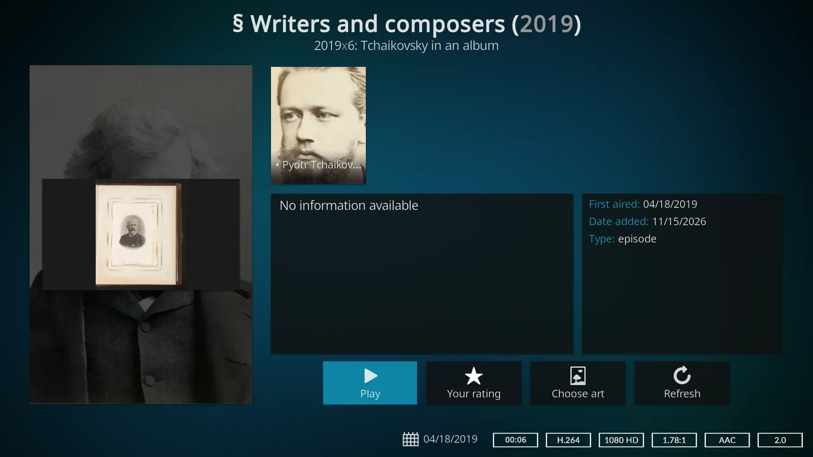</a><br><sub>Kodi: люди с лицами из Immich</sub></td>
  </tr>
  <tr>
    <td width="50%"><a href="docs/images/screenshots/app-album.webp">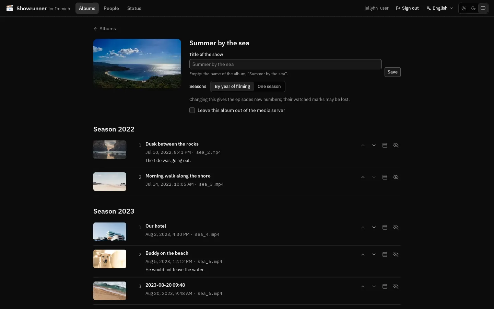</a><br><sub>Страница: альбом, его сезоны и эпизоды</sub></td>
    <td width="50%"><a href="docs/images/screenshots/app-people.webp">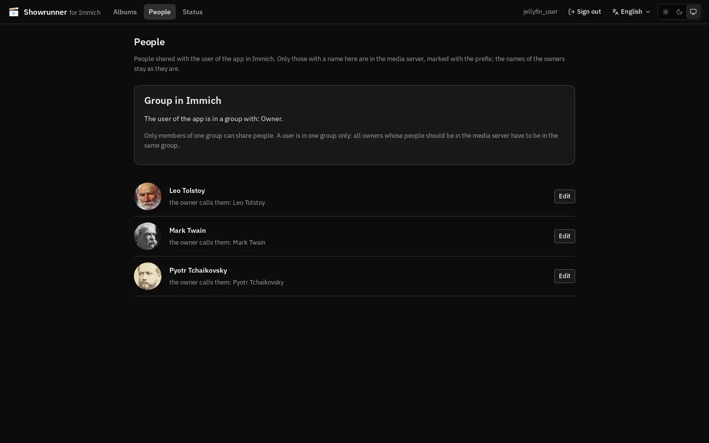</a><br><sub>Страница: люди и их имена</sub></td>
  </tr>
</table>

<sub>Видео на снимках сделаны из картинок Wikimedia Commons в общественном достоянии или под CC0.</sub>

## Идея

- **Выбор — в Immich, а не в ещё одном приложении.** Заведите в Immich пользователя для
  медиасервера и поделитесь с ним альбомом — его видео появятся в медиасервере. Перестали делиться —
  исчезли.
- **Альбом = сериал, видео = эпизод.** Сезоны — годы съёмки или один сезон на альбом. Название
  эпизода — первая строка описания видео в Immich или время съёмки; картинки эпизодов — те же, что
  в Immich.
- **Свои картинки.** Постер, широкая картинка, фон и логотип сериала и постер каждого сезона
  рисуются из кадров видео альбома, так, чтобы лица были видны, в одном из девяти стилей. Без
  генерации картинок ИИ: всё работает на процессоре вашего сервера. На странице можно попробовать
  другой стиль или другие кадры — для всех картинок или для одной — и закрепить понравившиеся.
- **Слайдшоу из фото** (включены по умолчанию, выключаются на странице): ролик на каждый год из фото альбома, в Specials
  его сериала, под свободную музыку из набора или вашу; фото меняются в такт, камера медленно
  приближается к лицам. Скриншоты, документы и почти одинаковые снимки отбрасываются. Всё работает
  на процессоре вашего сервера; фото никуда не уходят.
- **Люди из Immich** — под своими именами для медиасервера («мама» у вас останется «мамой») и с
  коротким префиксом, чтобы не смешиваться с актёрами вашей фильмотеки.
- **Работает само**, а для случаев, где угадало не так, есть веб-страница: переименовать сериал
  или эпизод, поменять порядок, скрыть видео, дать людям имена и описания. На английском,
  немецком, французском, итальянском и русском.
- **Jellyfin, Kodi или оба.** У каждого своя папка — из тех же альбомов и с теми же правками, и
  каждому сообщается о любом изменении. Kodi не нужно дополнений, и в интернете он ничего не
  ищет; Kodi с дополнением Jellyfin видит сериалы через Jellyfin.

## Принципы

- **Без копий.** Ни один видеофайл не дублируется.
- **Библиотека Immich только для чтения.** Приложение никогда не меняет, не перемещает и не
  удаляет файлы Immich. Оно пишет только в свои папки и удаляет там только созданное им самим.
- **Само ничего не пишет в Immich.** Фоновая синхронизация работает с ключом только на чтение, а
  ваши правки хранятся в базе приложения. Исключения — то, что вы сами делаете на странице для
  пользователя медиасервера: имя человека, которым с ним поделились (только для этого
  пользователя), и принятие приглашения в группу.
- **Можно пересобрать.** Папки для медиасерверов можно удалить и собрать заново.

## Слайдшоу

Фото каждого альбома становятся роликами с музыкой, которые собираются на процессоре вашего
сервера: по ролику на год, «Photos 2024», в Specials (сезон 0) его сериала, после эпизодов этого
года. Слайдшоу включены по умолчанию; выключаются на странице «Слайдшоу» или для одного альбома на
его странице.

1. **Фото просматриваются** один раз, в фоне синхронизаций: что на каждом (модель изображений CLIP
   на процессоре), лица из Immich, почти одинаковые снимки.
2. **Монтажный лист**: фото в порядке съёмки, разбитые на сцены по паузам и переездам. Из почти
   одинаковых остаётся лучший; скриншоты, документы и чеки отбрасываются, фото с лицом — никогда.
   Год — не дольше двадцати минут, частями по три–пять; если все фото в двадцать минут не
   помещаются, каждый день даёт свою долю.
3. **Музыка** подбирается по тому, что на фото (спокойная, светлая, бодрая, кинематографичная), из
   свободного набора в 35 пьес или ваша; фото меняются в такт, ролик заканчивается вместе с фразой.
4. **Картинка**: камера медленно приближается к лицам, вертикальное фото показывается целиком
   поверх своей размытой копии, панорама проходится вдоль; внутри сцены — наплывы, между сценами —
   затемнения.
5. **Титул и титры** в стиле альбома: название; под ним, мельче, дата («март–июль 2024» у части
   года); и где сняты фото, до трёх городов. Текст слайдшоу — на любом из пяти языков страницы.

На странице альбома — его слайдшоу (посмотреть или скачать), настроение музыки и почему каждое
фото не попало в ролик. В первый раз большая библиотека обрабатывается часами; ролики появляются
по одному, начиная с последних лет. `showrunner preview-titles` за минуты рисует только титулы,
чтобы их просмотреть. [Подробнее о слайдшоу](docs/install.md#9-slideshows) (на английском).

## Установка

Showrunner запускается через Docker Compose на машине, где лежит библиотека Immich; Jellyfin
может работать в Docker или быть установлен пакетом, Kodi читает свою папку по SMB. Образ
готовый, для `amd64` и `arm64`:

```sh
mkdir immich-showrunner && cd immich-showrunner
curl -L -o compose.yaml https://github.com/Ivamic/immich-showrunner/releases/latest/download/compose.yaml
curl -L -o example.env https://github.com/Ivamic/immich-showrunner/releases/latest/download/example.env
cp example.env .env      # адреса и ключи Immich, Jellyfin и Kodi, папки
docker compose run --rm app check
docker compose run --rm app sync --dry-run
docker compose up -d
```

Обновление — `docker compose pull && docker compose up -d`. [Установка по шагам](docs/install.md)
(на английском): пользователь и API-ключ в Immich, сопоставление путей, медиатеки в Jellyfin и
Kodi, веб-страница, люди.

## Устройство

- Python (FastAPI), PostgreSQL; один контейнер для приложения и один для его базы.
- Веб-страница — приложение SvelteKit, собранное в образ и отдаваемое приложением.
- Контейнер приложения монтирует только свои папки вывода. Immich он читает через API ключом
  только на чтение и файлов библиотеки не видит.
- Синхронизация сначала составляет план по тому, что сообщает Immich, и по реестру созданных
  файлов, а потом выполняет его; `sync --dry-run` останавливается на плане.

## Поддержать проект

Showrunner бесплатный и делается в свободное время. Если он вам пригодился, можно поддержать
разработку пожертвованием в криптовалюте. Звезда репозиторию, сообщения об ошибках и рассказ о
проекте тоже помогают.

| Валюта | Сеть | Адрес |
|---|---|---|
| USDT | TRON (TRC-20) | `TAqGEvmDTw2ro4BKQmcPPtqK5xEMfNaiSX` |
| ETH, USDT и другие токены | Ethereum и EVM-сети (Base, Polygon, Arbitrum…) | `0x783C192d69fE5E9DAfa1dC2c41FeE272122AE031` |
| SOL | Solana | `38gidbL2ocv5c6CK7zP7c3QWVHisYyqhnrMV3tuaYpgp` |
| BTC | Bitcoin | `bc1qsdys5hvx7vlxp25mz77hfgz2l35x8klc8z2npx` |

Перед отправкой проверьте сеть: средства, отправленные по другой сети, могут потеряться.

## Лицензия

Copyright (C) 2026 Ivamic.

[GNU Affero General Public License v3.0 или новее](LICENSE) (`AGPL-3.0-or-later`).

**Название и логотип.** Название «Showrunner for Immich» и логотип (`docs/images/logo.svg`,
`frontend/src/lib/assets/favicon.svg` и знак в `frontend/src/lib/ui/Brand.svelte`) не входят в
лицензию AGPL; все права принадлежат автору. Ими можно пользоваться, чтобы сослаться на этот
проект. Форки и изменённые версии должны использовать другое название и логотип.

## Помощь ИИ

Проект разрабатывается с помощью инструментов ИИ (Claude от Anthropic). Весь код проверяет и
сопровождает человек — автор.

## Оговорка

Это независимый проект сообщества. Он не связан с проектом Immich, FUTO, проектом Jellyfin и
Kodi Foundation и не одобрен ими.
